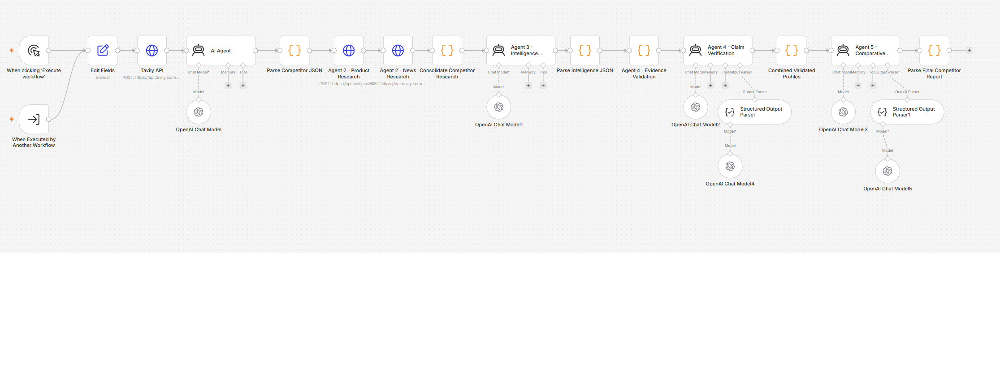
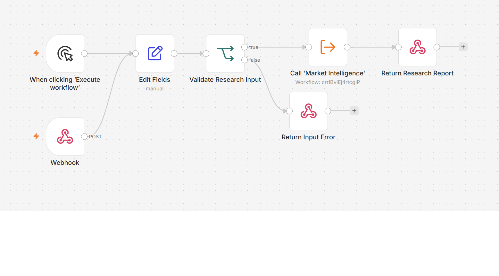
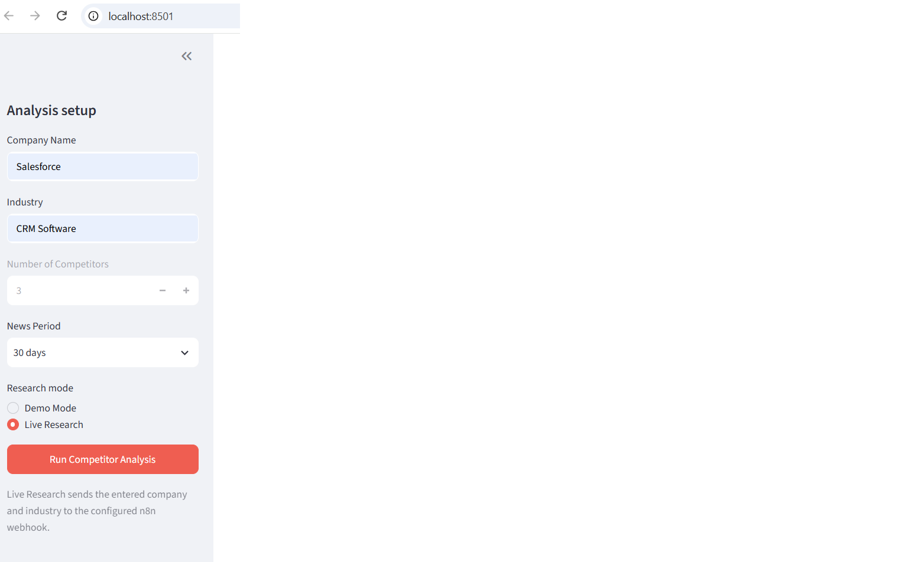

# Multi-Agent Market Intelligence & Competitor Analysis

An AI-assisted competitive research proof of concept that accepts a company
and industry, gathers market information through an n8n-orchestrated research
pipeline, and presents a structured intelligence report in Streamlit. The
system combines Tavily Search API research and OpenAI-powered agent steps with
a user-facing dashboard.

> **Evidence note:** The repository includes the Streamlit app and exported
> n8n workflow JSON files. The application behavior and workflow configuration
> can be reviewed from source; reported Salesforce, Adobe, and live dashboard
> tests are identified as user-reported in
> [docs/testing-results.md](docs/testing-results.md), not independently
> rerun for this documentation update.

## Problem statement

Market and competitor analysis requires gathering information from multiple
sources, comparing product positioning and news, and distinguishing evidence
from unsupported claims. Doing this manually is time-consuming and can make
findings difficult to compare or reproduce. This project demonstrates a
structured workflow that organizes research into sequential agent stages and
returns a consistent report for business review.

It is a research aid, not a source of guaranteed or independently audited
business facts. Users should inspect sources and validate conclusions before
acting on them.

## Features

The following behavior is visible in `app.py`:

- Collects a company name, industry, fixed competitor count (3), and news
  window (7, 30, or 90 days).
- Starts in **Demo Mode**. Demo organizations, metrics, and market signals are
  explicitly fictional; this mode does not call n8n.
- Provides an opt-in **Live Research** mode that submits a JSON POST to the
  configured n8n webhook.
- Displays an executive summary, competitor comparison, SWOT analysis,
  strategic recommendations, and research limitations from a valid response.
- Validates required report fields and reports request, timeout, HTTP, JSON,
  and response-shape errors in the dashboard.

## Solution overview

The n8n parent Orchestrator invokes the research pipeline sequentially:

1. Competitor Discovery (Tavily)
2. Product and News Research
3. Intelligence Extraction
4. Evidence and Claim Validation
5. Comparative Analysis and Reporting

The pipeline progresses from competitor discovery and product/news research
through structured intelligence extraction, evidence and claim validation,
and comparative analysis. Tavily supplies web search, and OpenAI chat models
support agent reasoning and output generation as configured in the exported
workflows. The workflow JSON files and documentation describe the node-level
implementation; see [docs/architecture.md](docs/architecture.md) and
[docs/agent-design.md](docs/agent-design.md).

## Technology stack

| Component | Role | Evidence/status |
| --- | --- | --- |
| Python | Application runtime | Verified by `app.py` and `requirements.txt` |
| Streamlit | User interface and report display | Verified by `app.py` |
| `python-dotenv` | Loads variables from the project `.env` file | Verified by `app.py` and `requirements.txt` |
| n8n | Webhook endpoint, parent Orchestrator, and sequential sub-workflow | Sanitized public workflow copies are in `workflow/public/` |
| Tavily Search API | Search tool used by the research pipeline | Configured in the exported workflow; see agent-design documentation |
| OpenAI Chat Model | Language-model nodes for agent reasoning and structured results (`gpt-4.1-mini`) | Configured in the exported workflow; see agent-design documentation |

## Setup

### Requirements

- Python compatible with the installed Streamlit version (`streamlit>=1.57,<2.0`)
- Access to the n8n webhook for Live Research only

The app's Demo Mode does not require a running n8n workflow or provider
credentials.

### Install

From the project directory, create and activate a virtual environment, then
install the declared Python dependencies:

```powershell
py -m venv .venv
.\.venv\Scripts\Activate.ps1
python -m pip install -r requirements.txt
```

### Configure Live Research

Copy `.env.example` to `.env` and set `N8N_WEBHOOK_URL` to the webhook URL for
your environment. The application calls `load_dotenv` on the project `.env`
file; alternatively, configure these variables in the process environment.
The checked-in example uses a local URL and is only a template.

```powershell
Copy-Item .env.example .env
```

The optional `N8N_TIMEOUT_SECONDS` setting defaults to `300` and must be a
positive number. Adjust it to match the expected workflow duration. Keep
`.env` private; it is ignored by Git. Configure provider credentials through
n8n's credential mechanism; do not commit secrets or copy them into
documentation. Before publishing workflow exports, review them for
credential references and deployment-specific metadata. See
[docs/architecture.md](docs/architecture.md) for the webhook and workflow
interaction.

### Import and configure n8n

The exported workflows are:

- `workflow/public/market-intelligence-orchestrator-public.json` —
  webhook/manual entry, input validation, sub-workflow call, and HTTP
  response.
- `workflow/public/market-intelligence-research-pipeline-public.json` —
  sequential research, extraction, validation, and comparative analysis.

The original exports are retained locally at `workflow/` and excluded from
Git. The public copies omit credential references, deployment metadata, and
cached UI routes; both are inactive. Import them into n8n, reselect Tavily and
OpenAI credentials, and verify the Orchestrator's sub-workflow reference
resolves to the imported research workflow. Configure webhook authentication
or trusted gateway access before enabling or exposing the endpoint. Set
`N8N_WEBHOOK_URL` in Streamlit to the deployed webhook URL.

### Start the dashboard

```powershell
python -m streamlit run app.py
```

## Usage

1. Open the dashboard and enter a company name and industry.
2. Use the fixed three-competitor setting and choose a news period.
3. Leave **Demo Mode** selected to view a clearly labeled fictional example,
   or select **Live Research** when a reachable webhook is configured.
4. Select **Run Competitor Analysis**.
5. Review the report and its research limitations. Treat live output as
   research leads to verify, not as independently validated advice.

Live mode sends the following JSON body:

```json
{
  "company": "Example Company",
  "industry": "Business software",
  "competitor_count": 3,
  "news_days": 30
}
```

The response must be a JSON object with the fields below. The application also
accepts the common n8n single-item `[{ "json": { ... } }]` wrapper. See the
response-shape details in [docs/architecture.md](docs/architecture.md).

```json
{
  "executive_summary": "A concise summary.",
  "competitor_comparison": [
    {"competitor": "Sample competitor", "positioning": "Sample position"}
  ],
  "swot_analysis": {
    "strengths": ["Sample strength"],
    "weaknesses": ["Sample weakness"],
    "opportunities": ["Sample opportunity"],
    "threats": ["Sample threat"]
  },
  "strategic_recommendations": ["Sample recommendation"],
  "research_limitations": ["Sample limitation"]
}
```

## Documentation

- [System architecture and data flow](docs/architecture.md)
- [Agent responsibilities and contracts](docs/agent-design.md)
- [Testing scenarios and limitations](docs/testing-results.md)
- [Lessons learned and future enhancements](docs/lessons-learned.md)
- [3–5 minute demonstration script](docs/demo-script.md)

## Project Demonstration and Screenshots

The following project screenshots document the n8n workflow design and
Streamlit experience.

### Research Pipeline



The workflow view shows the ordered research stages, including Tavily search,
competitor selection, product and news research, intelligence extraction,
evidence review, comparative analysis, and structured output parsing.

### Orchestrator



The parent workflow receives a webhook or manual trigger, maps and validates
the research input, calls the `Market Intelligence` sub-workflow when valid,
and returns either the research report or an input error.

### Streamlit Analysis Results


The dashboard screenshot shows a completed Salesforce analysis with an
executive summary, three-competitor comparison, and SWOT sections.

### Streamlit Inputs



The sidebar shows the company and industry fields, fixed competitor count,
news period, research mode, and analysis action.

## Limitations

- Search results and model-generated synthesis can be incomplete, stale, or
  incorrect; validate important claims against original sources.
- Structured output validation checks report shape, not factual accuracy.
- Webhook execution is synchronous in the Streamlit app and subject to its
  configured timeout.
- User-reported executions are not accompanied by independently reviewed
  accuracy or performance measurements.
- The Streamlit competitor count is fixed at three to match the exported
  research workflow's three-profile output.
- Structured output validation and URL matching do not independently prove
  factual accuracy or that a cited page supports a claim.
- The source webhook export has no configured authentication. The sanitized
  public copy is inactive; configure access controls before enabling or
  exposing it. See [docs/architecture.md](docs/architecture.md).
- Static security review identified an unauthenticated webhook (**🟡 MEDIUM**)
  and credential-reference/deployment metadata in exports (**⚪ LOW**).
  No embedded API keys or bearer-token values were found. Sanitize metadata
  before public publication and protect the endpoint before deployment.

## Submission-readiness checklist

- [x] Document the Streamlit interface and its webhook request/response
  contract.
- [x] Document both exported workflows, the sequential agent stages, their
  tools, and known validation constraints.
- [x] Label reported Salesforce, Adobe, Demo Mode, and empty-input results as
  user-reported rather than independently verified.
- [x] Record security findings without copying credential identifiers or
  secret values into documentation.
- [x] Fix the Streamlit competitor count at three to match the research
  pipeline.
- [ ] Add authentication or trusted gateway controls before exposing the
  n8n webhook to untrusted callers.
- [ ] Sanitize credential references and workflow/instance identifiers in
  workflow exports before public release.
- [ ] Verify the final n8n response against Streamlit's required fields using
  a sanitized execution record.
- [ ] Attach sanitized evidence for reported runs and document human review
  of source-backed claims.

The documentation is ready for review. The unchecked items require workflow
configuration changes or additional test evidence and are intentionally not
performed in this documentation-only update.
