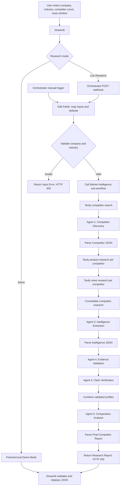

# System Architecture

## Overview and evidence

The exported n8n configuration implements a parent **Market Intelligence
Orchestrator** that validates a webhook request and invokes a sequential
research sub-workflow. The research pipeline executes competitor discovery,
product and news search, intelligence extraction, preliminary evidence
checks, claim review, and comparative reporting. It does not implement
independent agent delegation or autonomous task routing.

The Streamlit frontend provides fictional Demo Mode and opt-in Live Research.
The n8n JSON files document workflow configuration; user-reported test runs
are separately labeled in [testing-results.md](testing-results.md).

## Components

- **Streamlit (`app.py`):** collects a company, industry, competitor count,
  and news window; displays fictional demo data or calls the n8n webhook;
  validates required fields in the final JSON and renders the report.
- **n8n Orchestrator:** accepts a POST webhook or a manual trigger, maps
  inputs/defaults, validates non-empty company and industry, invokes the
  research sub-workflow on its valid path, and returns a JSON report or
  validation error.
- **Research sub-workflow:** can be triggered manually or by the Orchestrator.
  It performs Tavily HTTP requests and sequential agent/processing stages,
  then parses and returns a final report.
- **Tavily Search API:** called by HTTP Request nodes using bearer
  authentication configured through an n8n credential reference. No key is
  embedded in the workflow export.
- **OpenAI Chat Model:** the exported model nodes use `gpt-4.1-mini`. Models
  are connected to the competitor-selection, extraction, claim-review, and
  comparative-analysis agents. Structured Output Parser nodes are attached to
  claim review and final comparison.

## Mermaid architecture and execution sequence



The Tavily product/news requests and the agents are regular main-flow nodes,
not independent tool-connected agent delegations. OpenAI model and parser
connections attach to selected agent nodes and are not represented as
separate stages above.

## Orchestrator and webhook

The Orchestrator has a `POST` webhook at path `market-intelligence` configured
to respond through a response node. A manual trigger also feeds the same
input-mapping and validation path.

The input-mapping node reads `company`, `industry`, `news_days`, and
`competitor_count` from the request body, with root-level fallbacks. Missing
values are mapped to empty company/industry strings, `30` news days, and `3`
competitors. Validation requires trimmed company and industry to be
non-empty; the exported validation does not impose numeric bounds on the two
numeric options.

- **Valid path:** passes `company`, `industry`, `news_days`, and
  `competitor_count` to the `Market Intelligence` sub-workflow and returns
  the resulting `$json` as JSON with HTTP 200.
- **Invalid path:** returns
  `{"success": false, "error": "Company name and industry are required."}`
  with HTTP 400.
- **Sub-workflow execution mode:** not explicitly specified in the exported
  Execute Workflow node options.
- **Webhook authentication:** the exported webhook does not configure
  authentication. An exposed instance should be protected with suitable
  webhook authentication or a trusted access-control gateway.

## Research data flow

1. Research workflow `Edit Fields` normalizes the incoming fields. If the
   workflow is started directly without company/industry values, its own
   defaults are `Salesforce` and `CRM software`; numeric defaults are 30 days
   and 3 competitors. In the Orchestrator path, empty company/industry are
   rejected before invoking it.
2. A Tavily general web-search POST finds candidate competitors. Agent 1
   selects and describes competitors from those search results.
3. The competitor JSON parse step feeds product and news Tavily HTTP searches
   per competitor. Product search uses general topic; news search uses news
   topic and `news_days`.
4. Consolidation aligns competitor, product, and news records by item
   position, checks item counts, and checks that product/news query strings
   contain the competitor company name.
5. Agent 3 extracts structured competitor intelligence from the consolidated
   research.
6. Evidence Validation matches extracted profiles by normalized company name
   and compares cited URLs with URLs in the Tavily product/news results.
   Claim Verification reviews reported claims and the preliminary findings.
7. Combined profiles are matched by normalized company name and the workflow
   requires exactly three profiles. Agent 5 generates a comparative report,
   which is parsed and returned through the Orchestrator.

The URL comparison is a source-presence check, not proof that a page supports
its associated claim. Agent 4's prompt explicitly states that it has no
independent web access and must not claim to have opened or verified pages.
See [agent-design.md](agent-design.md) for details.

## Request and response shapes

The Streamlit app sends this JSON request in Live Research:

```json
{
  "company": "Example Company",
  "industry": "Business software",
  "competitor_count": 3,
  "news_days": 30
}
```

The final pipeline report is intended to include `target_company`,
`industry`, `executive_summary`, `competitor_comparison`, `swot_analysis`,
`market_opportunities`, `strategic_recommendations`, `research_limitations`,
and `overall_conclusion`. The final parse node checks for
`target_company`, `executive_summary`, `competitor_comparison`,
`swot_analysis`, and `strategic_recommendations`, requires exactly three
competitor records, and adds `report_status: "Generated - Pending Final
Review"`.

The Streamlit app separately requires these fields:
`executive_summary`, `competitor_comparison`, `swot_analysis`,
`strategic_recommendations`, and `research_limitations`. It normalizes the
common n8n `[{ "json": { ... } }]` wrapper and checks broad types and required
SWOT sections. Confirm the deployed Orchestrator response satisfies that
frontend contract; the workflow's final report parse requirements do not
establish field-by-field compatibility on their own.

## Integration and configuration items to review

- Streamlit fixes the competitor count at three, matching the pipeline's
  “top 3” prompt, three-profile combination check, and final parser
  requirement.
- The research workflow's direct-trigger defaults can yield Salesforce/CRM
  research if inputs are omitted; the Orchestrator rejects blank company and
  industry before a sub-workflow call.
- Original workflow exports contain n8n credential references and
  deployment-specific identifiers. Sanitized public copies under
  `workflow/public/` remove these references and are inactive. Reselect
  provider credentials and verify the Orchestrator-to-pipeline link after
  import.
- Configure webhook authentication or gateway access control before exposing
  the unauthenticated webhook. Input validation is not caller authentication.

## Security review and publication risks

This is a static review of the original workflow exports; no services were
started and no requests were sent. The sanitized public copies are under
`workflow/public/`; originals remain unchanged and are excluded from Git.

- **🟡 MEDIUM — unauthenticated webhook:** The active Orchestrator POST
  webhook has no configured authentication. Any caller able to reach the
  n8n instance can submit non-empty company and industry values, potentially
  trigger Tavily/OpenAI usage, and receive the resulting report. Apply
  webhook authentication or trusted gateway access controls before exposing
  the instance.
- **⚪ LOW — deployment metadata in originals:** The original workflow JSON
  includes credential references and workflow/instance identifiers. These
  are not provider secrets, but disclose credential bindings and deployment
  metadata. Public copies remove credential references, deployment metadata,
  and cached UI routes, and replace workflow IDs while updating the
  Orchestrator reference. Node IDs are preserved for import compatibility.
- **No embedded API keys or bearer tokens were found** in the reviewed
  exports. No secret values are reproduced in this documentation. Rotate
  provider credentials only if the actual secret values were exposed
  elsewhere.

These are security risks to address before publication/deployment. The
sanitized public webhook workflow is inactive but remains configured without
authentication; secure it before activation or exposure. Sanitization of the
public copies does not modify the original workflow exports or solve the
webhook access-control concern.
